# Biblio

Native apps for macOS, iOS and iPadOS, GNOME, Android, Windows and the terminal that work as a patron front
end to any public library catalog hosted on
[BiblioCommons](https://www.bibliocommons.com/libraries-we-work-with)
(`https://LIBRARY.bibliocommons.com/`).

Search the catalog, place and cancel holds, and keep track of checkouts and borrowing
history, all in an interface that follows each platform's own design. The apps share one
core, libbiblio, written in Zig; [PLATFORMS.md](PLATFORMS.md) describes how they fit together.

> Biblio is an independent project and isn't affiliated with or endorsed by BiblioCommons
> or any library.

## Screenshots

From the Apple app.

Copy status by location, color-coded: available, on order or in process, out, held, in transit.

<table>
<tr>
<td width="55%">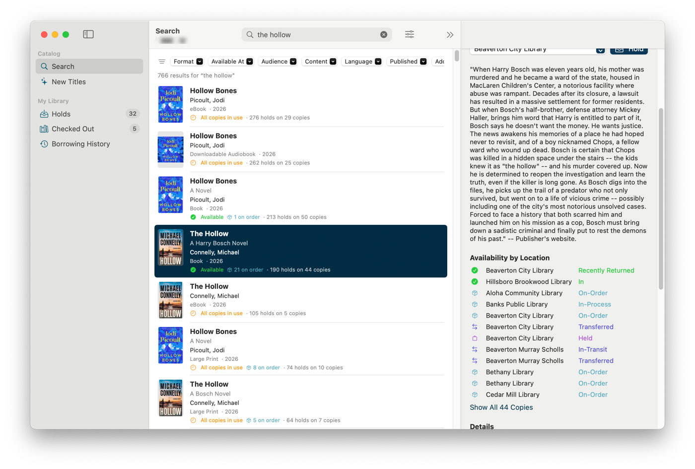</td>
<td>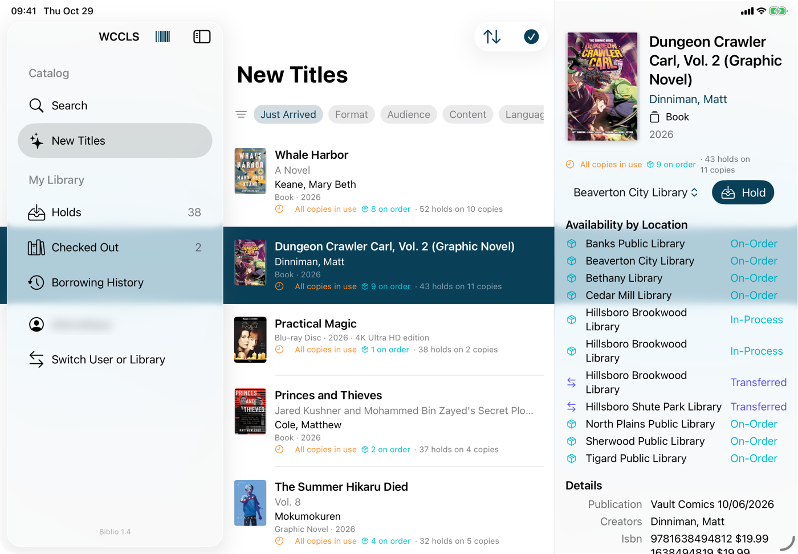</td>
</tr>
<tr>
<td align="center">macOS</td>
<td align="center">iPadOS: New Titles sorted by people waiting</td>
</tr>
</table>

<table>
<tr>
<td width="70%">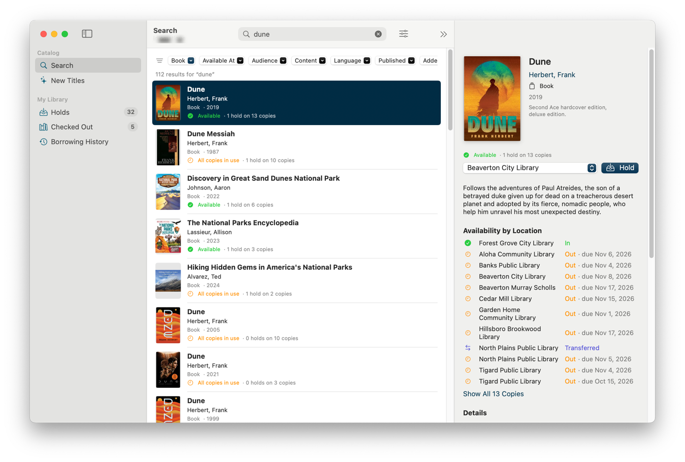</td>
<td>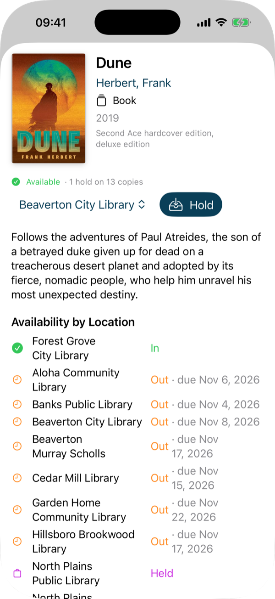</td>
</tr>
<tr>
<td align="center">Search with filters on macOS</td>
<td align="center">The same item on iPhone</td>
</tr>
</table>

<table>
<tr>
<td>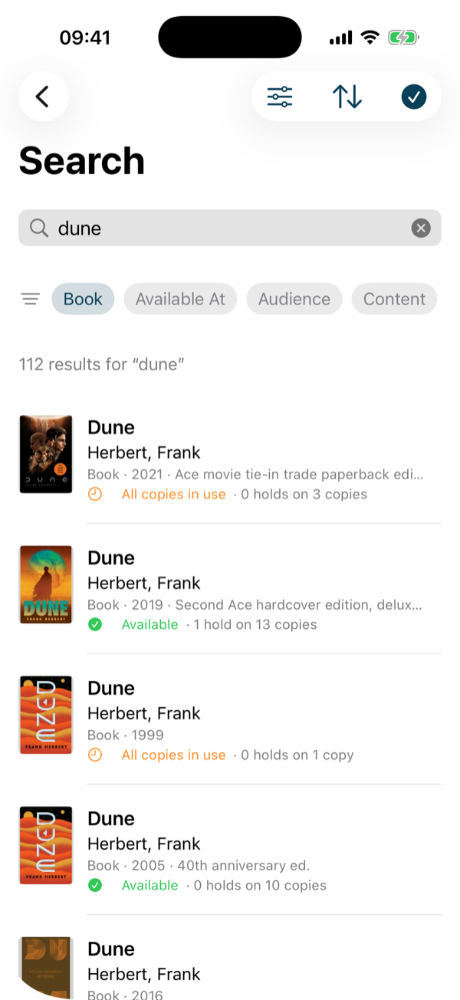</td>
<td>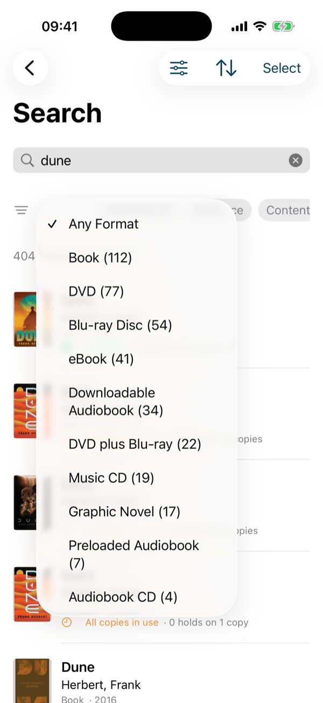</td>
<td>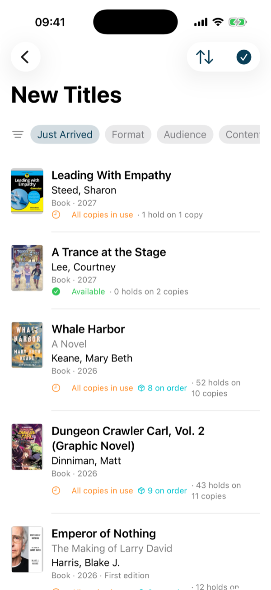</td>
<td>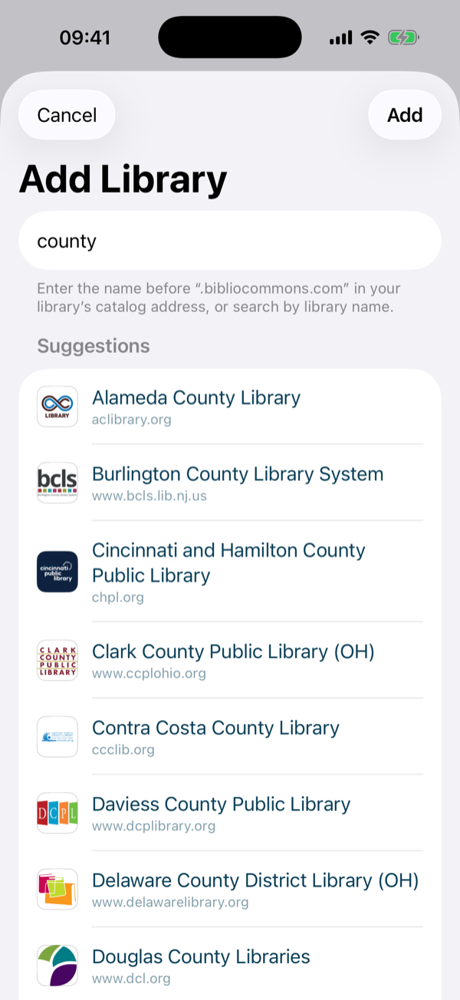</td>
</tr>
<tr>
<td align="center">Search</td>
<td align="center">Filters</td>
<td align="center">New titles</td>
<td align="center">Add a library</td>
</tr>
</table>

<table>
<tr>
<td width="58%">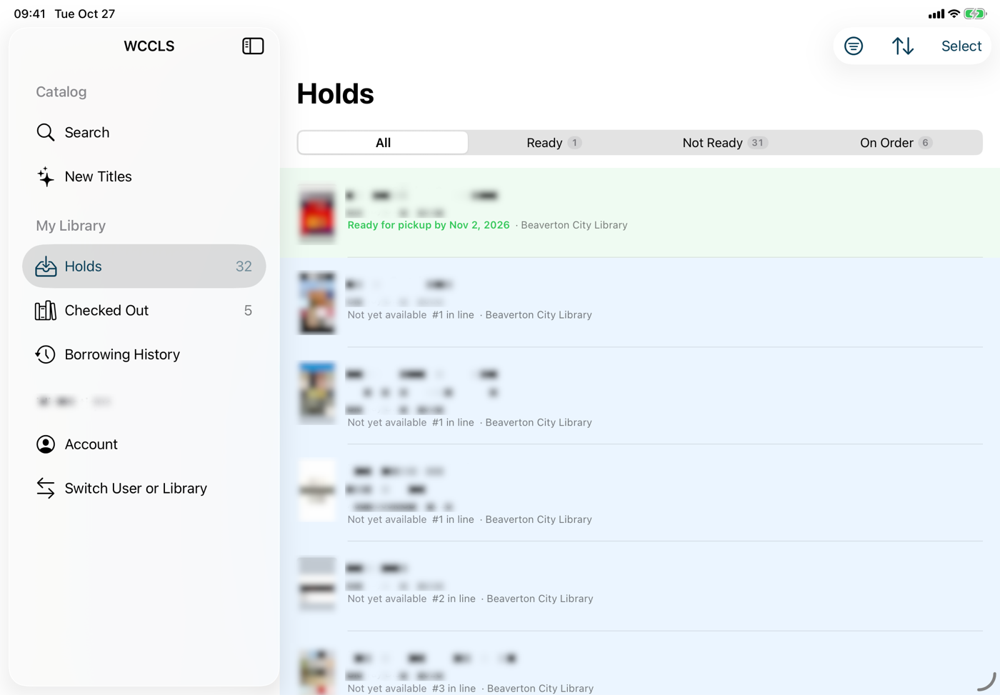</td>
<td>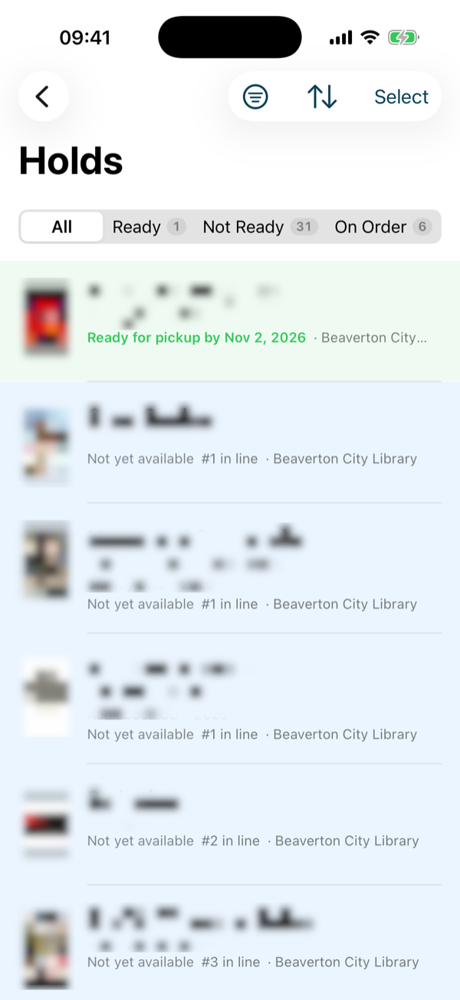</td>
<td>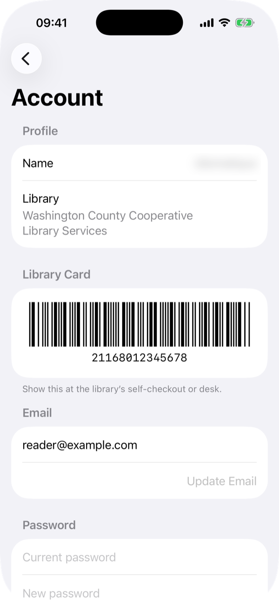</td>
</tr>
<tr>
<td align="center">Holds with filters and badges</td>
<td align="center">Ready for pickup</td>
<td align="center">Library card</td>
</tr>
</table>

<table>
<tr>
<td width="56%">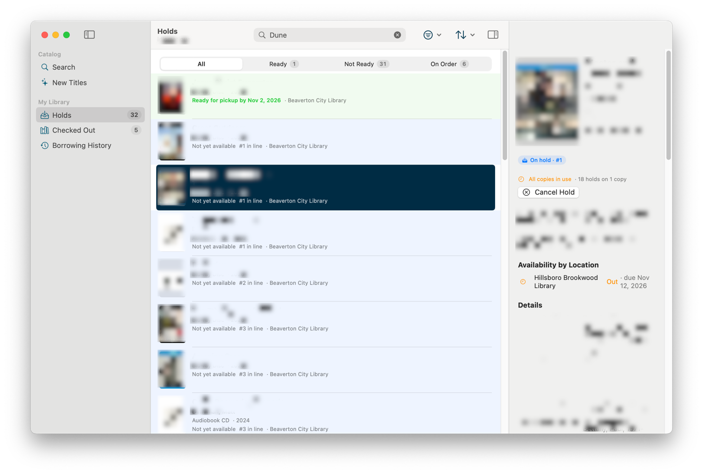</td>
<td>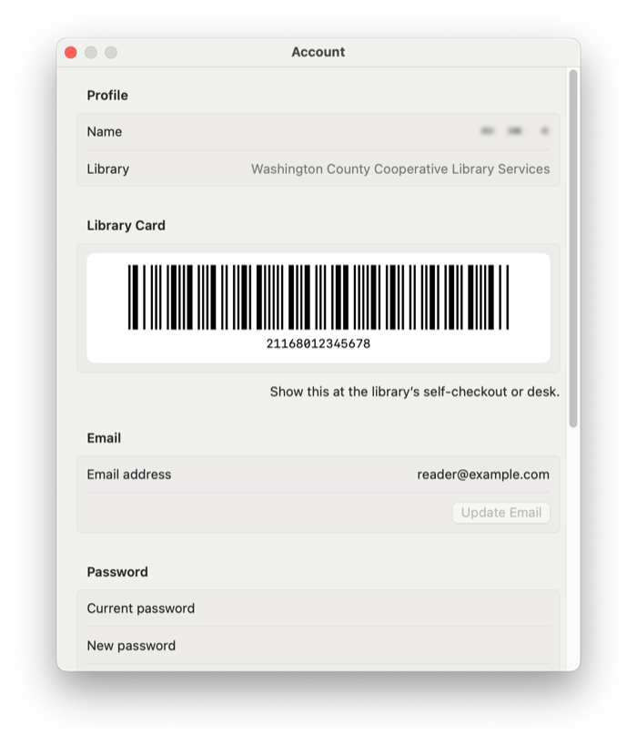</td>
<td>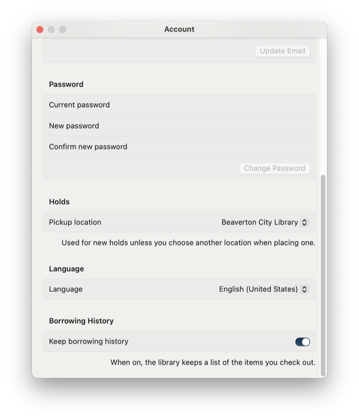</td>
</tr>
<tr>
<td align="center">Holds on macOS</td>
<td align="center">Library card and email</td>
<td align="center">Pickup, language, history</td>
</tr>
</table>

<table>
<tr>
<td width="50%">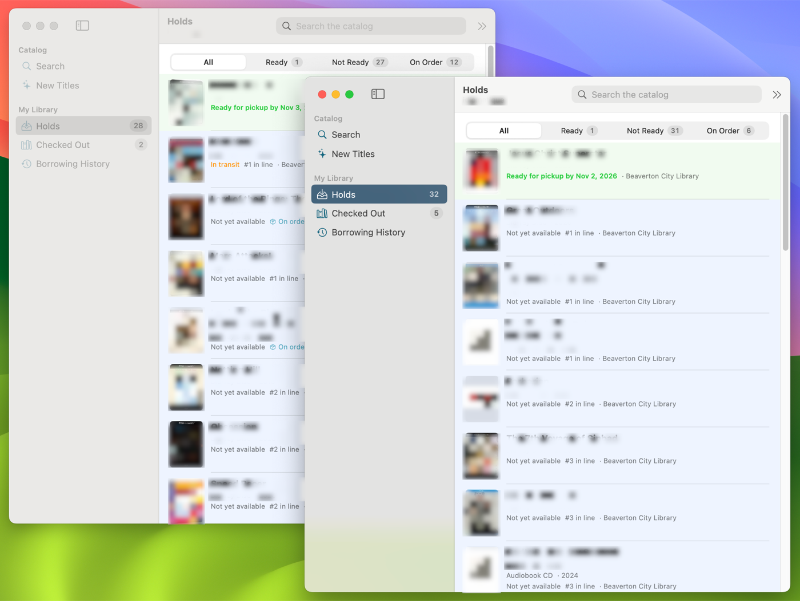</td>
<td>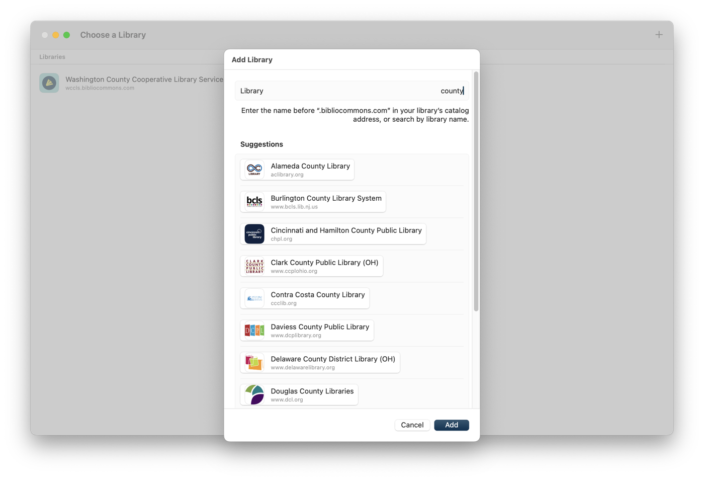</td>
</tr>
<tr>
<td align="center">One window per account</td>
<td align="center">Add a library</td>
</tr>
</table>

Hold titles and usernames are blurred; the card number and email are samples.

## Features

As in the Apple app. [PLATFORMS.md](PLATFORMS.md#notes) lists what the other apps don't have yet.

**Catalog**
- Search and advanced search (keyword, title, author, subject, …), with filters for format,
  availability location, audience, content, language, publication date and date added.
- Explore New Titles: Just Arrived and On Order, with the library's "Filter by" options.
- Infinite scrolling. The scroll bar starts at the full list length, and only the pages you
  actually scroll to are fetched.
- Sort orders, including by number of people waiting.
- An inspector with item details and copy availability by location, loaded in the background.

**Your account**
- Holds: place, cancel and filter by Ready, Not Ready and On Order, with count badges.
- Checked out items and borrowing history, with counts in the sidebar.
- Select several items in a list to place or cancel holds on all of them at once.
- List rows are subtly tinted to show your status for each item: on hold, ready for pickup,
  checked out or overdue.
- Your library card as a scannable Codabar barcode.
- Settings for email, password, pickup location, language and borrowing history. On macOS they
  live in the Settings window.

**App**
- Multiple windows, each with its own session: different libraries, different accounts, or
  different searches side by side.
- Add a library by its subdomain (`wccls`) or URL, with autocomplete from the BiblioCommons
  libraries directory.
- Credentials are stored in the Keychain, and expired sessions are renewed without
  interrupting you.
- Guest browsing without an account.
- Pull to refresh on iOS and iPadOS; View ▸ Refresh (⌘R) on macOS.
- Drag an item's cover onto Holds to place a hold, or onto a search field to search for it.
  On macOS this also works across windows.

## Requirements

| Platform | Needs |
|---|---|
| All | Zig 0.17 |
| macOS, iOS, iPadOS | Xcode 26 or later; runs on macOS 15 or later, or iOS / iPadOS 18 or later |
| GNOME | GTK 4, libadwaita 1.6 or later, libsecret |
| Android | The Android SDK and a JDK |
| Windows | The .NET 8 SDK and the Windows App SDK |
| Terminal | Nothing more; any xterm-256color terminal on macOS or Linux |

## Building

[PLATFORMS.md](PLATFORMS.md#building) has each platform's steps.

To try it, add a library such as `wccls` or `multcolib`, then sign in with a library card and
PIN, or choose **Browse as Guest**.

## Project layout

| Folder | Contents |
|---|---|
| `core` | libbiblio, the shared Zig core, and its C header |
| `apple` | The SwiftUI app for macOS, iOS and iPadOS |
| `gnome` | The GTK 4 and libadwaita app, in Zig |
| `android` | The Jetpack Compose app, and its Zig JNI shim |
| `windows` | The WinUI 3 app, in C# |
| `tui` | The terminal app, in Zig |
| `docs` | The [core developer guide](docs/core.md) and screenshots |

Inside the Apple app:

| Folder | Contents |
|---|---|
| `apple/Biblio/Model` | Data models, per-window session state, and the paged list model that drives infinite scrolling |
| `apple/Biblio/Net` | `BiblioClient` (an actor that handles sign-in and re-authentication), the gateway API calls, account-settings form handling, request throttling, and the library directory |
| `apple/Biblio/Store` | Keychain access, and the saved libraries with their branding |
| `apple/Biblio/Views` | SwiftUI views |

The app uses the same gateway API as the BiblioCommons web app. Account settings go through
the website's own forms. [NOTES-API.md](NOTES-API.md) lists the endpoints. Requests are
throttled to be gentle on library servers.

## How it was made

Biblio was written with [Claude Code](https://claude.com/claude-code).

## License

[BSD 3-Clause](LICENSE)
