# Biblio

Native apps for macOS, iOS, iPadOS, GNOME, Android, Windows, and the terminal that work as a
patron front end to any public library catalog hosted on
[BiblioCommons](https://www.bibliocommons.com/libraries-we-work-with)
(`https://LIBRARY.bibliocommons.com/`).

Search the catalog, place and cancel holds, and keep track of checkouts and borrowing
history, all in an interface that follows each platform's own design.
[CHANGELOG.md](CHANGELOG.md) lists what changed in each version.

> Biblio is an independent project and isn't affiliated with or endorsed by BiblioCommons
> or any library.

## Screenshots

One patron's visit, from first launch to picking up a film, in the Apple apps. The library, account, and card are made up; the titles and covers come from a real catalog.

### Get started

<table>
<tr>
<td>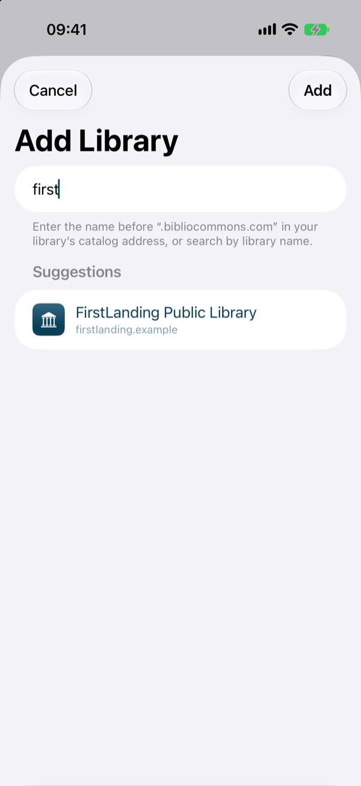</td>
<td>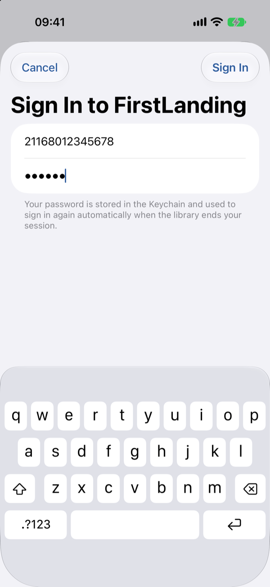</td>
</tr>
<tr>
<td align="center">Add your library</td>
<td align="center">Sign in</td>
</tr>
</table>

### Find and hold

<table>
<tr>
<td>
<picture>
<source media="(prefers-color-scheme: dark)" srcset="docs/screenshots/iphone-03-search-dark.png">
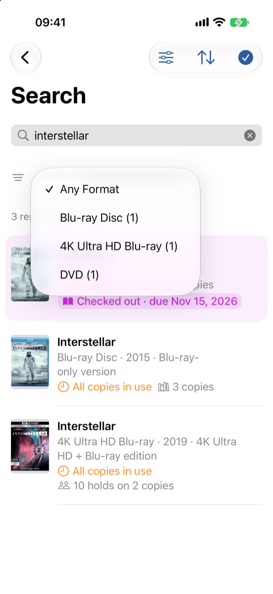
</picture>
</td>
<td>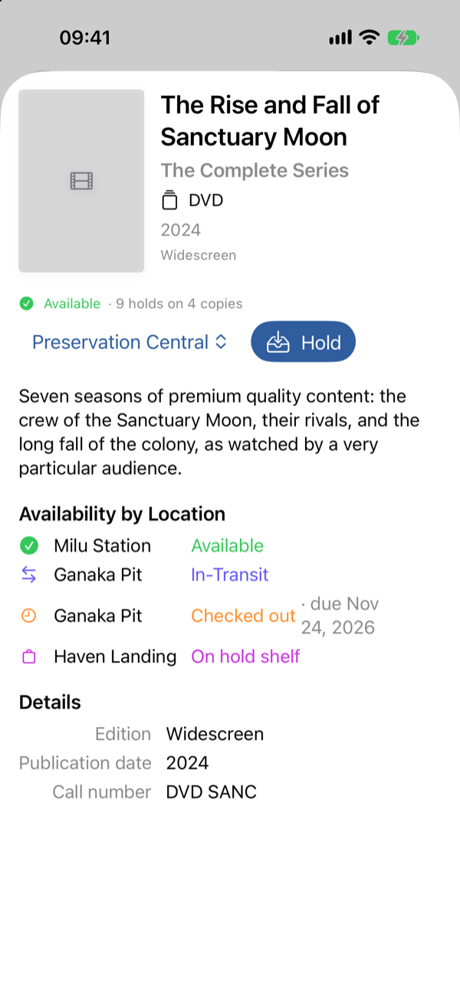</td>
<td>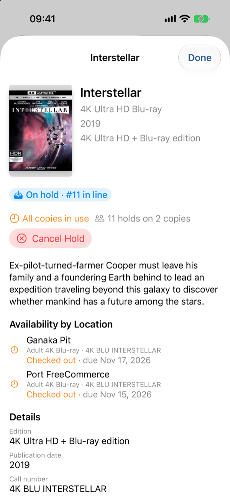</td>
</tr>
<tr>
<td align="center">Search with filters</td>
<td align="center">Copies by branch</td>
<td align="center">Hold placed</td>
</tr>
</table>

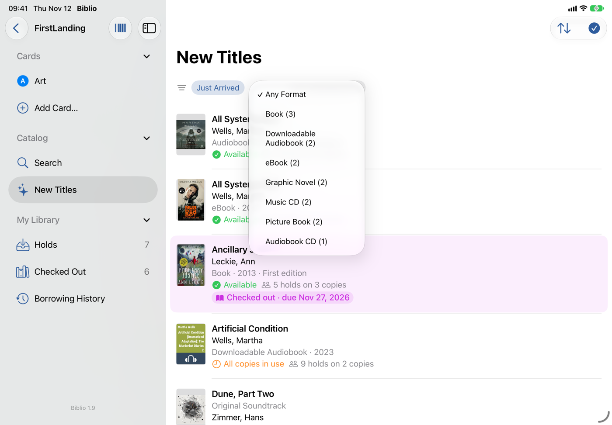

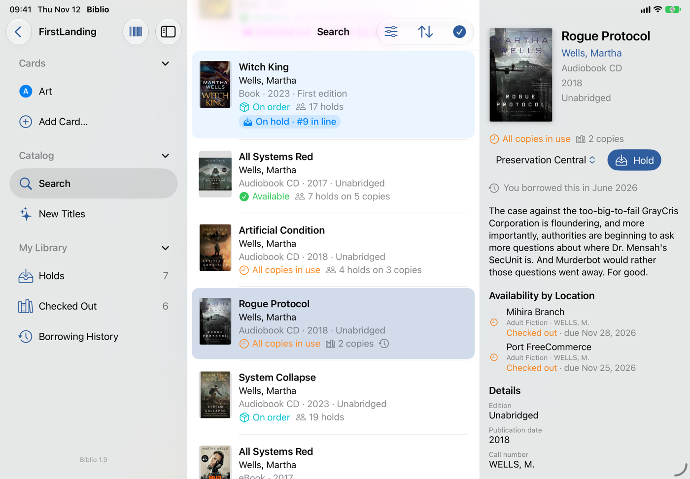

### Pick up

<table>
<tr>
<td>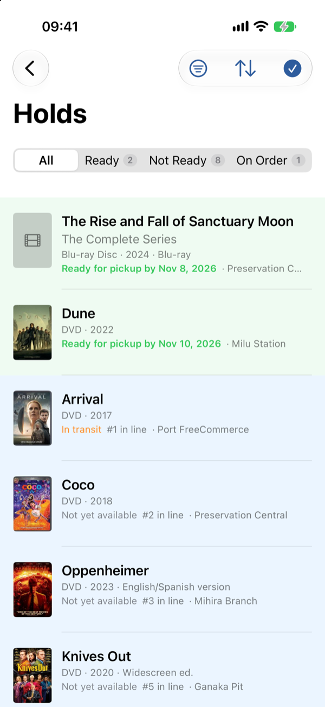</td>
<td>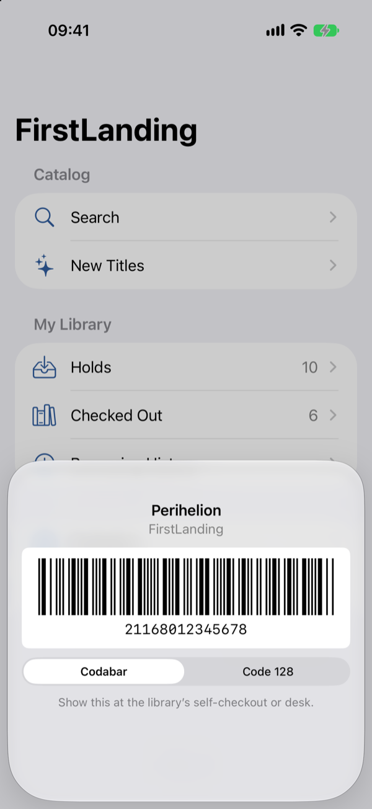</td>
<td width="58%">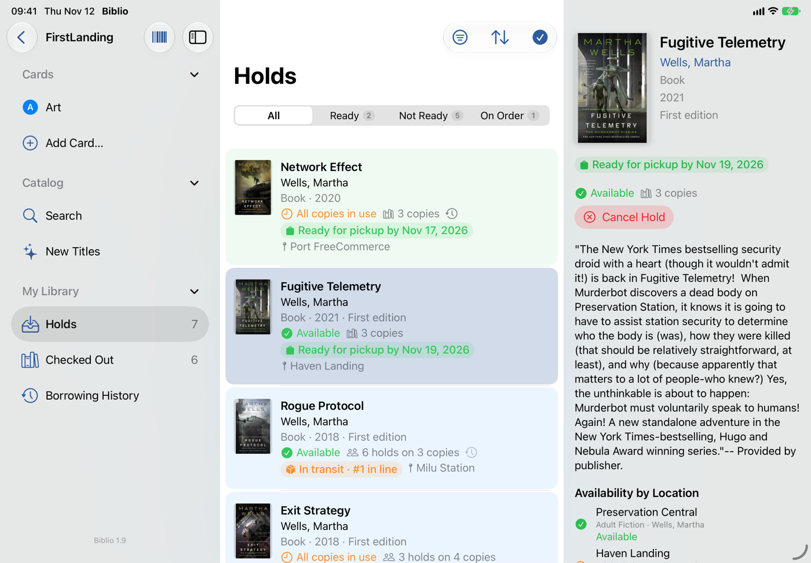</td>
</tr>
<tr>
<td align="center">Holds, ready first</td>
<td align="center">Library card</td>
<td align="center">iPadOS</td>
</tr>
</table>

### Keep track

<table>
<tr>
<td>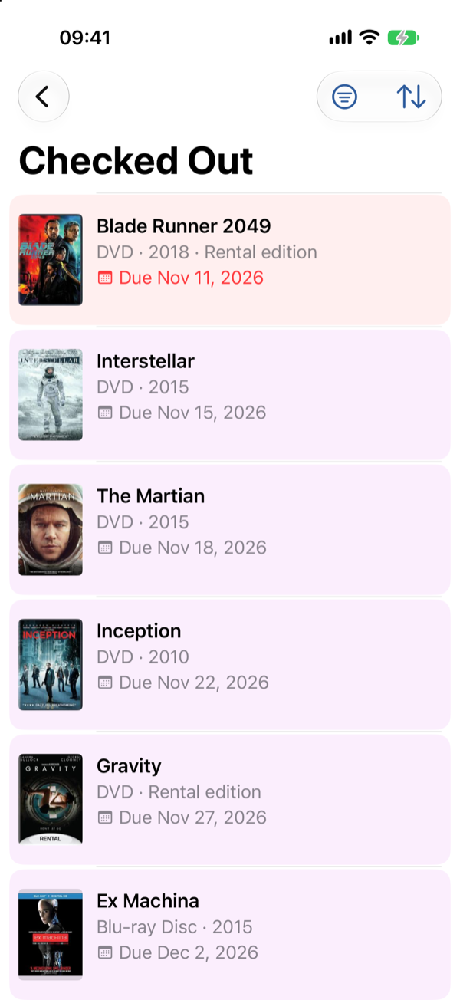</td>
<td>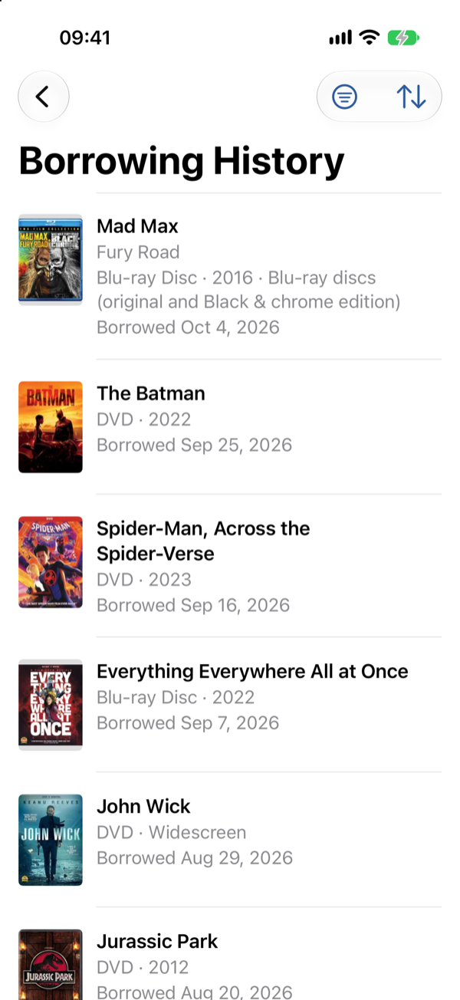</td>
<td width="58%">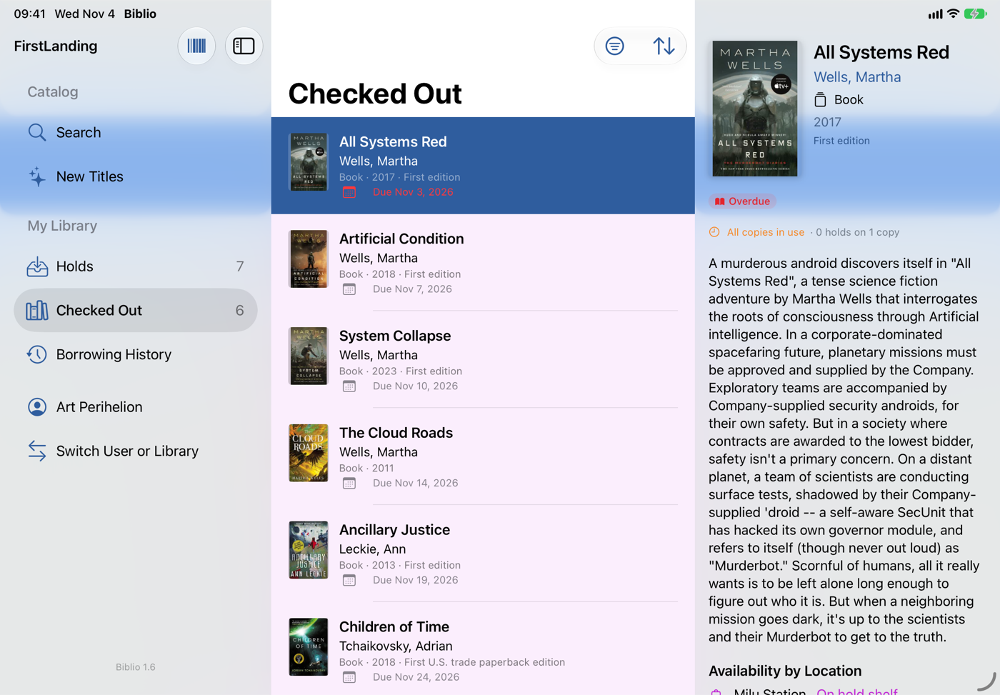</td>
</tr>
<tr>
<td align="center">Checked out</td>
<td align="center">Borrowing history</td>
<td align="center">iPadOS</td>
</tr>
</table>

### And more

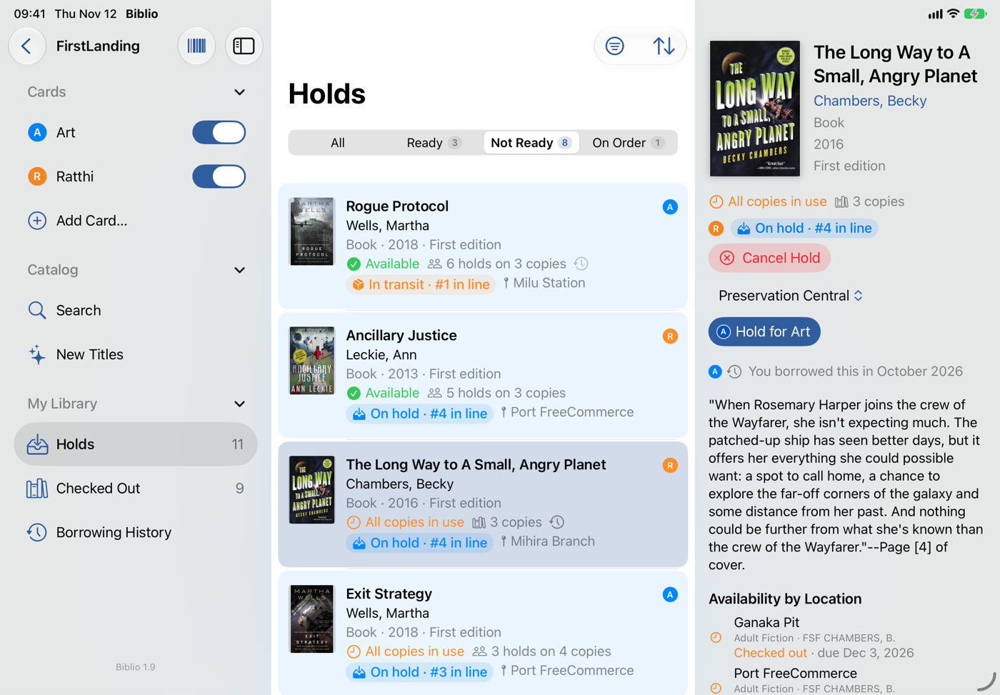

A household's cards together in one window

On Mac, drag a cover onto Holds to place a hold

<table>
<tr>
<td>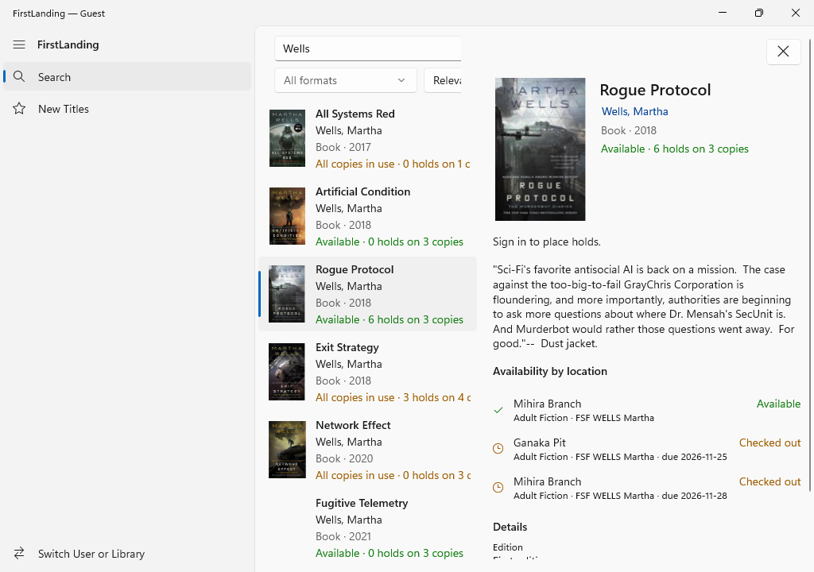</td>
<td>
<picture>
<source media="(prefers-color-scheme: dark)" srcset="docs/screenshots/gnome-coming-soon-dark.png">
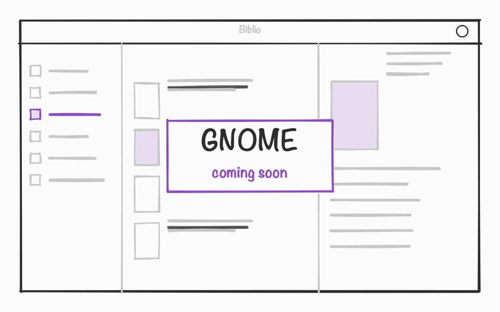
</picture>
</td>
<td width="18%">
<picture>
<source media="(prefers-color-scheme: dark)" srcset="docs/screenshots/android-coming-soon-dark.png">
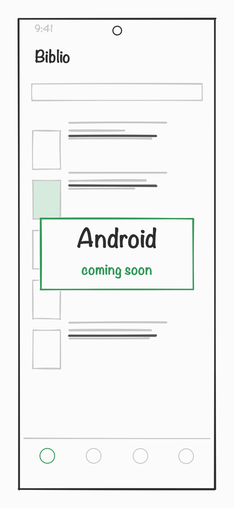
</picture>
</td>
</tr>
<tr>
<td align="center">Windows</td>
<td align="center">GNOME</td>
<td align="center">Android</td>
</tr>
</table>

## Features

**Find something to borrow**
- Search the catalog, narrow it by format, and, in the Apple apps, use advanced search with
  filters for audience, content, language, publication date, and more.
- Browse the library's new titles: what just arrived and what's on order.
- Sort by title (accents and case don't matter, and "Book 2" comes before "Book 10"), by
  author, by date, or by how many people are waiting.
- Scroll through long lists without paging; only what you look at is loaded.
- See every copy's status at each branch, with its collection and call number.
- Spot what you've borrowed before: those items are marked, and their details say when.
  Another format of something you've had, such as the audiobook of a book you read, is marked
  more faintly, and Not Borrowed hides what you've already had in that format. Your borrowing
  history stays on your device, and only while the library keeps it.
- Find 4K Ultra HD Blu-ray discs as their own format, even where the library files them as
  Blu-ray.

**Holds and checkouts**
- Place and cancel holds, choosing where to pick them up. Select several items to hold or
  cancel them all at once.
- See which holds are ready, in transit, or still waiting, and your place in line, with counts
  in the sidebar.
- Keep track of what's checked out and when it's due.
- Each list row is tinted by where you stand with it: on hold, ready, checked out, or overdue.

**Your library card**
- Show your card as a barcode the checkout desk can scan, Codabar or Code 128, whichever your
  library uses. On iPhone and iPad it's one tap from the toolbar, the Lock Screen, or Control
  Center, and you can swipe between the cards you have at that library.
- On iPhone and iPad, sign in by scanning the barcode on your physical card.

**Your accounts**
- Use several libraries, and several cards at each, each in its own window, or see a
  household's cards together in one window, each item marked with its card.
- Change your email, password, pickup location, language, and borrowing history on each card's
  page.
- Your passwords are kept in the system's secure storage (the Keychain, Secret Service,
  Android Keystore, or Windows Credential Locker), and you stay signed in as sessions expire.
  The terminal app asks for your password each time instead.
- Browse as a guest without signing in, then sign in when you want to place a hold.

**Everywhere**
- Each app follows its platform's own design, with the shortcuts and gestures you'd expect:
  pull to refresh on iPhone and iPad, ⌘R on Mac, and drag a cover onto Holds or a search field
  on Mac, iPhone, and iPad.

The Apple apps have every feature; the GNOME, Android, Windows, and terminal apps are catching
up, and don't yet offer advanced search, the Lock Screen card, or a combined window of several
cards.

## Requirements

| Platform | Runs on |
|---|---|
| macOS, iOS, iPadOS | macOS 15 or later; iOS or iPadOS 18 or later |
| GNOME | GTK 4, libadwaita 1.6 or later, and libsecret, on x86_64 or aarch64 Linux (including 64-bit Raspberry Pi OS) |
| Android | Android 10 or later |
| Windows | Windows 10 (1809) or later, x64 or ARM64 |
| Terminal | Any xterm-256color terminal on macOS or Linux |

To try it, add a library such as `wccls` or `multcolib`, then sign in with a library card and
PIN, or choose **Browse as Guest**.

## Development

The apps share one core, libbiblio, written in Zig, under a native UI on each platform.
[DEVELOPMENT.md](DEVELOPMENT.md) covers building, the project layout, testing, releasing, and
what comes next.

## How it was made

Biblio was written with [Claude](https://claude.com).

## License

[BSD 3-Clause](LICENSE)
